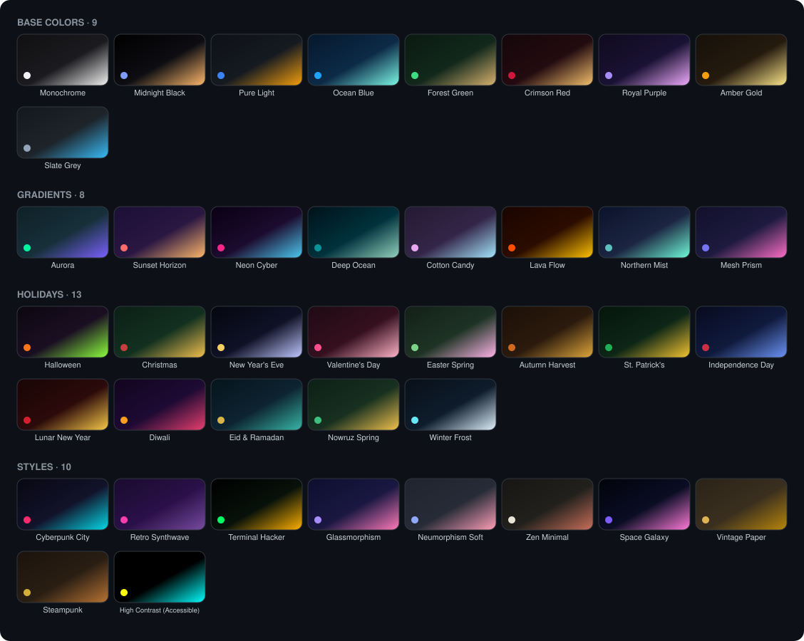

<div align="center">


# PreStream

A streaming front-end for the PrimeWire catalog — fast search, a multi-provider
player, watchlists and full account sync in a clean, modern interface.

[](https://prestream.dpdns.org)
[](https://nextjs.org)
[](https://react.dev)
[](https://www.typescriptlang.org)
[](https://tailwindcss.com)
[](LICENSE)

**Try it live → <https://prestream.dpdns.org>**

</div>

---

## ✨ Features

**Watch**
- Multi-provider player — VidSrc, VidLink, VidFast, 2Embed, Videm and Videasy, plus PrimeWire's own hosts; switch sources mid-watch with one click
- Watch progress syncs to your PrimeWire account; episode tracker for shows
- Trailer playback on detail pages

**Discover**
- Cinematic home feed with curated rows
- Faceted browse — type, genre, year, rating, country, cast, sort
- Instant search (`Ctrl`+`K`) with autocomplete
- Airing-schedule calendar
- Detail pages: ratings, cast, seasons, comments

**Organize**
- Watchlist and library statuses
- Playlists — build, curate and share collections
- Account hub: feed, messages, notifications, friends, forum, public profiles

**Personalize**
- 40 hand-tuned themes, all WCAG contrast-checked
- Guest mode — everything that doesn't need an account works without one

## 🎨 Themes

Nine base palettes, eight gradient atmospheres, thirteen holiday specials and
ten distinct styles — each with its own typography, textures and motion.
Every theme ships in light and dark, and every pairing is contrast-verified
(`scripts/verify-theme-contrast.ts`).

<div align="center">

</div>

## 🛠 Tech stack

| Layer | Tools |
| --- | --- |
| Framework | Next.js 16 (App Router), React 19, TypeScript |
| UI | Tailwind CSS 4, shadcn/ui, Lucide, Framer Motion |
| State | Zustand, TanStack Query |
| Backend | Route handlers, cheerio, Prisma + SQLite |
| Deploy | Standalone build, Render blueprint |

## 🚀 Getting started

```bash
git clone https://github.com/Abdullayews/PreStream.git
cd PreStream
bun install    # or: npm install
bun run dev    # http://localhost:3000
```

Zero-config boot: the SQLite database and its schema are created automatically
on first run — no env vars, no migrations. Sign in with a PrimeWire account to
sync, or keep browsing as a guest.

| Script | Description |
| --- | --- |
| `bun run dev` | Dev server on `:3000` |
| `bun run build` | `prisma generate` + standalone production build |
| `bun run start` | Production server (binds `0.0.0.0`, honors `$PORT`) |
| `bun run lint` | ESLint |
| `bun run db:push` | Push the Prisma schema to SQLite |

### Environment variables — all optional

| Variable | Default | Description |
| --- | --- | --- |
| `DATABASE_URL` | `file:<cwd>/db/custom.db` | SQLite location — point at a mounted disk for persistence |
| `PRESTREAM_SELF_PING_URL` | auto-detected | URL the keep-alive loop pings once a minute |
| `PRESTREAM_SELF_PING` | — | Set to `off` to disable the keep-alive loop |

## ☁️ Deploy

The repo ships a [`render.yaml`](render.yaml) blueprint — Node 22, free plan,
`/api/health` health check, no configuration required.

[](https://render.com/deploy?repo=https%3A%2F%2Fgithub.com%2FAbdullayews%2FPreStream)

Any other Node host works too — `npm run build` + `npm run start`.

> Free-tier notes: the disk is ephemeral, so SQLite data resets on every
> deploy — attach a disk and point `DATABASE_URL` at it for persistence.
> The built-in keep-alive loop pings `/api/health` once a minute so the
> instance never sleeps.

## 📁 Project structure

```
src/
├─ app/api/           # route handlers: primewire proxy, account sync, users, health
├─ components/prime/  # UI components
├─ lib/primewire/     # scraping client: parsers, mirror failover, sessions
├─ themes/            # theme definitions + registry
└─ proxy.ts           # cache-header policy
prisma/schema.prisma  # Profile model
scripts/              # theme generator + contrast checker
```

## 🔌 API overview

| Route | Returns |
| --- | --- |
| `GET /api/primewire/home` | Curated home catalog |
| `GET /api/primewire/browse` | Faceted search |
| `GET /api/primewire/detail` | One title: cast, ratings, seasons, comments |
| `GET /api/primewire/player` | Resolved embed sources for a movie/episode |
| `GET /api/primewire/autocomplete` | Instant search suggestions |
| `GET /api/primewire/image` | Poster/backdrop proxy |
| `GET /api/primewire/schedule` | Airing schedule |
| `GET /api/primewire/playlists` | Public playlists |
| `/api/account/*` | PrimeWire account sync: library, playlists, forum, friends, messages, … |
| `POST /api/users/register` | Local profile registry |
| `GET /api/health` | Liveness probe — `{ ok, uptimeSec }` |

## 🗺 Roadmap

- [ ] PostgreSQL adapter for persistent deploys
- [ ] Docker setup
- [ ] E2E test suite
- [ ] i18n (`next-intl`)

## ⚖️ Disclaimer

PreStream is an independent, open-source project and is not affiliated with
PrimeWire or any streaming provider. It hosts no video files — it is a
front-end that surfaces catalog metadata and third-party embeds. Use
responsibly and in accordance with your local laws.

## 📄 License

MIT — see [LICENSE](LICENSE).
